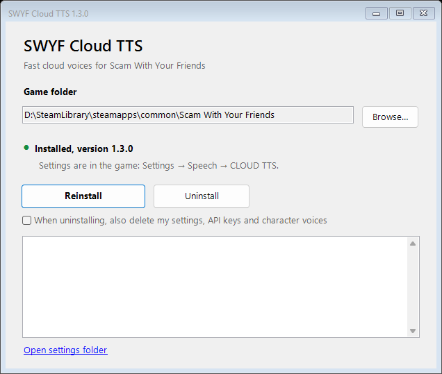

<div align="center">


# SWYF Cloud TTS

**Fast cloud voices for *Scam With Your Friends* instead of the slow local Qwen model.**

[](https://github.com/kyripkaraw/swyf-cloud-tts/releases/latest)

[](LICENSE)

**English** · [Українська](README.uk.md) · [Русский](README.ru.md)

</div>

## Why

| | Built-in Qwen | SWYF Cloud TTS |
|---|---|---|
| First line spoken after | 60+ s (model load) | ~1–5 s, depending on the provider |
| CPU / GPU load | high | almost none |
| Voices | one, average quality | a separate voice for every character |
| Internet | not needed | required |

- **The game's own files stay untouched.** Only the speech worker is swapped, and the original is kept as a backup.
- **A voice per character.** Characters are recognised by the voice clip the game sends, and each keeps the voice you pick.
- **Settings live in the game:** *Settings → Speech → CLOUD TTS*, styled like the game's own settings, in English, Ukrainian or Russian.
- **Safe failures.** A network or key problem means a silent line, never a crash.

## Install

1. Download **`SWYF-CloudTTS-Setup-vX.Y.Z.exe`** from [Releases](https://github.com/kyripkaraw/swyf-cloud-tts/releases/latest).
2. Run it and press **Install**. The game is found through Steam automatically.
3. Start the game and open **Settings → Speech → CLOUD TTS**: pick a provider, paste your API key, press **Apply**, then **Test voice**.

<div align="center">

</div>

> [!IMPORTANT]
> A Steam update of the game switches the mod off. Open the setup again (or *Settings → Apps → SWYF Cloud TTS → Modify*) and press **Repair**.

> [!NOTE]
> Windows SmartScreen may warn about an unknown publisher: *More info → Run anyway*. The sources and build scripts are in this repository.

### Or with Switchboard (BepInEx)

The mod is also a single BepInEx 5 plugin, **`SwyfCloudTts.dll`**, for the community mod manager [Switchboard](https://switchboard.ras-rap.click/). It speaks inside the game itself: no worker process, no game files replaced, and the game's own Qwen model is never downloaded.

1. Install BepInEx with Switchboard (*Setup → Set up / repair*).
2. Install the mod from *Get mods*, or put `SwyfCloudTts.dll` from **`SWYF-CloudTTS-BepInEx-vX.Y.Z.zip`** into `BepInEx\plugins`.
3. Settings are the same card: **Settings → Speech → CLOUD TTS**.

Use one of the two, not both: uninstall the setup version (settings stay) before installing BepInEx, because both load through `winhttp.dll`.

## Providers

| Provider | Good for | Cost |
|---|---|---|
| Google AI (Gemini TTS) | trying the mod out | free tier with a small daily limit, then paid |
| OpenAI `gpt-4o-mini-tts` | cheap everyday play | pay as you go |
| ElevenLabs | best quality; on Starter clones every character's own game voice (the 10 voice slots rotate automatically) | **Free plan works** with default and your own designed voices; cloning needs Starter |
| Qwen3-TTS on your own GPU | cloning without per-line costs | your server |

API keys: [Google AI Studio](https://aistudio.google.com/apikey) · [OpenAI](https://platform.openai.com/api-keys) · [ElevenLabs](https://elevenlabs.io).
Details for every provider: [full guide (Ukrainian)](docs/GUIDE.uk.md).

### Completely free: ElevenLabs Free

1. Sign up at [elevenlabs.io](https://elevenlabs.io) (Free plan, no card) and create a key under *Developers → API keys*.
2. In the card pick **ElevenLabs**, paste the key, **Apply**, **Test voice**.

Every character gets one of 21 default voices matching their pitch. You can also design up to 3 voices of your own from a text description (*Voices → Create a voice → Voice Design*), press **Load my voices** and give one to the boss. 10,000 credits a month last about 20 minutes of speech.

> [!TIP]
> By default the game sends only non-English calls to its AI voice. Set **Cloud voices for → All calls** in the card to voice English calls too.

## Character voices

The **CHARACTERS** list in the same card shows everyone the game has voiced so far.
Press **Play** to hear the game's original voice, give the character a name, and pick a voice for them.
Changes apply from the next line; no restart needed.

## Troubleshooting

| Symptom | What to do |
|---|---|
| Characters are silent | In the card press **Test voice**: key, quota and network errors are shown there. |
| The first line takes a minute again | A game update switched the mod off: run the setup and press **Repair**. |
| Black screen after the logo | Uninstall with the setup, then [report a bug](https://github.com/kyripkaraw/swyf-cloud-tts/issues/new/choose) with `%LOCALAPPDATA%\SWYF-CloudTTS\boot.log`. |
| Anything else | Attach `%LOCALAPPDATA%\SWYF-CloudTTS\worker.log` to a bug report. |

## Uninstall

*Settings → Apps → SWYF Cloud TTS → Uninstall*, or **Uninstall** in the setup window.
The original worker comes back. Your settings stay in `%LOCALAPPDATA%\SWYF-CloudTTS` unless you tick
*also delete my settings*. Steam → *Properties → Installed Files → Verify integrity* always returns the game to stock.

## Building from source

Requires the .NET 8 SDK and the game installed (the in-game card compiles against the game's own assemblies).

```powershell
.\build.ps1      # worker, in-game card and setup -> dist\
.\release.ps1    # version checks and smoke test -> artifacts\SWYF-CloudTTS-Setup-vX.Y.Z.exe
.\plugin\build-bepinex.ps1   # BepInEx plugin -> artifacts\SWYF-CloudTTS-BepInEx-vX.Y.Z.zip
```

How it works, the config format and the worker protocol: [docs/GUIDE.uk.md](docs/GUIDE.uk.md). Plans: [docs/ROADMAP.md](docs/ROADMAP.md).

## Disclaimer

An unofficial fan mod, not affiliated with the developers of *Scam With Your Friends*.
The text of dialogue lines is sent to the provider you choose. [MIT license](LICENSE);
third-party components: [THIRD_PARTY_NOTICES.md](THIRD_PARTY_NOTICES.md).
