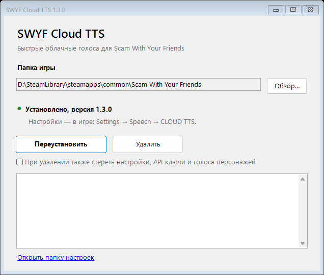

<div align="center">


# SWYF Cloud TTS

**Быстрые облачные голоса для *Scam With Your Friends* вместо медленной локальной модели Qwen.**

[](https://github.com/kyripkaraw/swyf-cloud-tts/releases/latest)

[](LICENSE)

[English](README.md) · [Українська](README.uk.md) · **Русский**

</div>

## Зачем

| | Встроенный Qwen | SWYF Cloud TTS |
|---|---|---|
| Первая реплика через | 60+ с (загрузка модели) | ~1–5 с, в зависимости от провайдера |
| Нагрузка CPU/GPU | высокая | почти нулевая |
| Голоса | один, среднее качество | отдельный голос для каждого персонажа |
| Интернет | не нужен | нужен |

- **Собственные файлы игры не изменяются.** Подменяется только процесс озвучки, оригинал сохраняется как резервная копия.
- **Голос для каждого персонажа.** Персонажи распознаются по голосовому клипу, который отправляет игра, и каждый сохраняет выбранный голос.
- **Настройки — прямо в игре:** *Settings → Speech → CLOUD TTS*, в стиле самой игры, на русском, английском или украинском.
- **Безопасные сбои.** Проблема с сетью или ключом даёт беззвучную реплику, а не вылет.

## Установка

1. Скачайте **`SWYF-CloudTTS-Setup-vX.Y.Z.exe`** со страницы [Releases](https://github.com/kyripkaraw/swyf-cloud-tts/releases/latest).
2. Запустите и нажмите **Установить**. Игра будет найдена через Steam автоматически.
3. Запустите игру и откройте **Settings → Speech → CLOUD TTS**: выберите провайдера, вставьте API-ключ, нажмите **Apply**, затем **Test voice**.

<div align="center">

</div>

> [!IMPORTANT]
> Обновление игры в Steam отключает мод. Откройте установщик ещё раз (или *Параметры → Приложения → SWYF Cloud TTS → Изменить*) и нажмите **Восстановить**.

> [!NOTE]
> Windows SmartScreen может предупредить о неизвестном издателе: *Подробнее → Выполнить в любом случае*. Исходный код и скрипты сборки — в этом репозитории.

## Провайдеры

| Провайдер | Для чего | Стоимость |
|---|---|---|
| Google AI (Gemini TTS) | попробовать мод | бесплатный тариф с маленьким дневным лимитом, дальше платно |
| OpenAI `gpt-4o-mini-tts` | недорого на каждый день | оплата за использование |
| ElevenLabs | лучшее качество; на Starter клонирует голос каждого персонажа из игры (10 слотов ротируются автоматически) | **работает и на бесплатном Free** со стандартными и вашими собственными голосами; клонирование — от Starter |
| Qwen3-TTS на своей GPU | клонирование без платы за реплику | ваш сервер |

API-ключи: [Google AI Studio](https://aistudio.google.com/apikey) · [OpenAI](https://platform.openai.com/api-keys) · [ElevenLabs](https://elevenlabs.io).
Подробности о каждом провайдере: [полное руководство (на украинском)](docs/GUIDE.uk.md).

### Полностью бесплатно: ElevenLabs Free

1. Зарегистрируйтесь на [elevenlabs.io](https://elevenlabs.io) (тариф Free, без карты) и создайте ключ в *Developers → API keys*.
2. В карточке выберите **ElevenLabs**, вставьте ключ, **Применить**, **Проверить голос**.

Каждый персонаж получит один из 21 стандартного голоса по высоте своего голоса. Ещё до 3 собственных голосов можно создать по текстовому описанию (*Voices → Create a voice → Voice Design*), нажать **Загрузить мои голоса** и отдать один боссу. 10 000 кредитов в месяц — это примерно 20 минут речи.

> [!TIP]
> По умолчанию игра отдаёт своему AI-голосу только неанглийские звонки. Выберите в карточке **Облачные голоса для → Всех звонков**, чтобы озвучивались и английские.

## Голоса персонажей

Список **CHARACTERS** в той же карточке показывает всех, кого игра уже озвучивала.
**Play** — послушать оригинальный голос из игры; персонажа можно подписать и выбрать ему голос.
Изменения действуют со следующей реплики, перезапуск не нужен.

## Если что-то не так

| Симптом | Что делать |
|---|---|
| Персонажи молчат | В карточке нажмите **Test voice**: ошибки ключа, квоты или сети видны там. |
| Первая реплика снова ждёт минуту | Обновление игры отключило мод: запустите установщик и нажмите **Восстановить**. |
| Чёрный экран после логотипа | Удалите мод установщиком и [создайте отчёт](https://github.com/kyripkaraw/swyf-cloud-tts/issues/new/choose) с файлом `%LOCALAPPDATA%\SWYF-CloudTTS\boot.log`. |
| Другое | Приложите к отчёту `%LOCALAPPDATA%\SWYF-CloudTTS\worker.log`. |

## Удаление

*Параметры → Приложения → SWYF Cloud TTS → Удалить* или кнопка **Удалить** в установщике.
Оригинальный озвучиватель возвращается. Настройки остаются в `%LOCALAPPDATA%\SWYF-CloudTTS`, если не
поставить галочку *также стереть настройки*. Steam → *Свойства → Установленные файлы → Проверить целостность*
всегда возвращает игру к исходному состоянию.

## Сборка из исходников

Нужны .NET 8 SDK и установленная игра (карточка в игре компилируется против собственных сборок игры).

```powershell
.\build.ps1      # воркер, карточка в игре и установщик -> dist\
.\release.ps1    # проверка версий и smoke-тест -> artifacts\SWYF-CloudTTS-Setup-vX.Y.Z.exe
```

Как это работает, формат конфига и протокол воркера: [docs/GUIDE.uk.md](docs/GUIDE.uk.md). Планы: [docs/ROADMAP.md](docs/ROADMAP.md).

## Отказ от ответственности

Неофициальный фанатский мод, не связан с разработчиками *Scam With Your Friends*.
Текст реплик отправляется выбранному вами провайдеру. [Лицензия MIT](LICENSE);
сторонние компоненты — [THIRD_PARTY_NOTICES.md](THIRD_PARTY_NOTICES.md).
