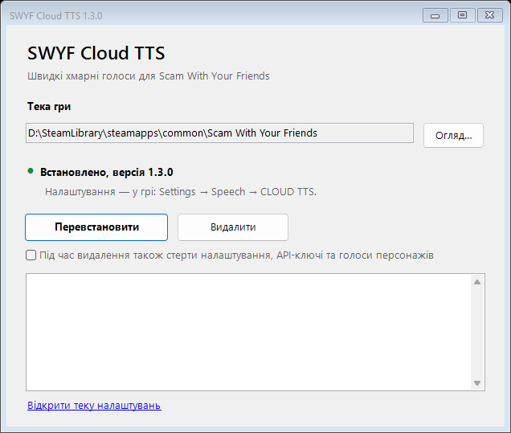

<div align="center">


# SWYF Cloud TTS

**Швидкі хмарні голоси для *Scam With Your Friends* замість повільної локальної моделі Qwen.**

[](https://github.com/kyripkaraw/swyf-cloud-tts/releases/latest)

[](LICENSE)

[English](README.md) · **Українська** · [Русский](README.ru.md)

</div>

## Навіщо

| | Вбудований Qwen | SWYF Cloud TTS |
|---|---|---|
| Перша репліка через | 60+ с (завантаження моделі) | ~1–5 с, залежно від провайдера |
| Навантаження CPU/GPU | високе | майже нульове |
| Голоси | один, посередня якість | окремий голос для кожного персонажа |
| Інтернет | не потрібен | потрібен |

- **Власні файли гри не змінюються.** Підміняється лише процес озвучення, оригінал зберігається як резервна копія.
- **Голос для кожного персонажа.** Персонажі розпізнаються за голосовим кліпом, який надсилає гра, і кожен зберігає обраний голос.
- **Налаштування — прямо в грі:** *Settings → Speech → CLOUD TTS*, у стилі самої гри, українською, англійською або російською.
- **Безпечні збої.** Проблема з мережею чи ключем дає беззвучну репліку, а не виліт.

## Встановлення

1. Завантажте **`SWYF-CloudTTS-Setup-vX.Y.Z.exe`** зі сторінки [Releases](https://github.com/kyripkaraw/swyf-cloud-tts/releases/latest).
2. Запустіть і натисніть **Встановити**. Гру буде знайдено через Steam автоматично.
3. Запустіть гру й відкрийте **Settings → Speech → CLOUD TTS**: оберіть провайдера, вставте API-ключ, натисніть **Apply**, потім **Test voice**.

<div align="center">

</div>

> [!IMPORTANT]
> Оновлення гри в Steam вимикає мод. Відкрийте інсталятор ще раз (або *Параметри → Програми → SWYF Cloud TTS → Змінити*) і натисніть **Відновити**.

> [!NOTE]
> Windows SmartScreen може попередити про невідомого видавця: *Докладніше → Виконати однаково*. Вихідний код і скрипти збірки — у цьому репозиторії.

### Або через Switchboard (BepInEx)

Мод також є одним плагіном BepInEx 5, **`SwyfCloudTts.dll`**, для менеджера модів спільноти [Switchboard](https://switchboard.ras-rap.click/). Він говорить прямо всередині гри: без окремого процесу, без заміни файлів гри, а власна модель Qwen гри взагалі не завантажується.

1. Встановіть BepInEx через Switchboard (*Setup → Set up / repair*).
2. Встановіть мод у *Get mods* або покладіть `SwyfCloudTts.dll` з **`SWYF-CloudTTS-BepInEx-vX.Y.Z.zip`** у `BepInEx\plugins`.
3. Налаштування — та сама картка: **Settings → Speech → CLOUD TTS**.

Використовуйте щось одне: перед встановленням BepInEx видаліть версію з інсталятора (налаштування лишаться), бо обидві завантажуються через `winhttp.dll`.

## Провайдери

| Провайдер | Для чого | Вартість |
|---|---|---|
| Google AI (Gemini TTS) | спробувати мод | безкоштовний тариф із малим добовим лімітом, далі платно |
| OpenAI `gpt-4o-mini-tts` | недорого на кожен день | оплата за використання |
| ElevenLabs | найкраща якість; на Starter клонує голос кожного персонажа з гри (10 слотів ротуються автоматично) | **працює й на безкоштовному Free** зі стандартними та вашими власними голосами; клонування — від Starter |
| Qwen3-TTS на власній GPU | клонування без плати за репліку | ваш сервер |

API-ключі: [Google AI Studio](https://aistudio.google.com/apikey) · [OpenAI](https://platform.openai.com/api-keys) · [ElevenLabs](https://elevenlabs.io).
Подробиці про кожного провайдера: [повний посібник](docs/GUIDE.uk.md).

### Повністю безкоштовно: ElevenLabs Free

1. Зареєструйтеся на [elevenlabs.io](https://elevenlabs.io) (тариф Free, без картки) і створіть ключ у *Developers → API keys*.
2. У картці оберіть **ElevenLabs**, вставте ключ, **Застосувати**, **Перевірити голос**.

Кожен персонаж отримає один із 21 стандартного голосу за висотою свого голосу. Ще до 3 власних голосів можна створити з текстового опису (*Voices → Create a voice → Voice Design*), натиснути **Завантажити мої голоси** й дати один босу. 10 000 кредитів на місяць — це приблизно 20 хвилин мовлення.

> [!TIP]
> За замовчуванням гра віддає своєму AI-голосу лише неанглійські дзвінки. Оберіть у картці **Хмарні голоси для → Усіх дзвінків**, щоб озвучувались і англійські.

## Голоси персонажів

Список **CHARACTERS** у тій самій картці показує всіх, кого гра вже озвучувала.
**Play** — послухати оригінальний голос із гри; можна підписати персонажа й обрати йому голос.
Зміни діють з наступної репліки, перезапуск не потрібен.

## Якщо щось не так

| Симптом | Що робити |
|---|---|
| Персонажі мовчать | У картці натисніть **Test voice**: помилки ключа, квоти чи мережі видно там. |
| Перша репліка знову чекає хвилину | Оновлення гри вимкнуло мод: запустіть інсталятор і натисніть **Відновити**. |
| Чорний екран після логотипу | Видаліть мод інсталятором і [створіть звіт](https://github.com/kyripkaraw/swyf-cloud-tts/issues/new/choose) з файлом `%LOCALAPPDATA%\SWYF-CloudTTS\boot.log`. |
| Інше | Додайте до звіту `%LOCALAPPDATA%\SWYF-CloudTTS\worker.log`. |

## Видалення

*Параметри → Програми → SWYF Cloud TTS → Видалити* або кнопка **Видалити** в інсталяторі.
Оригінальний озвучувач повертається. Налаштування лишаються в `%LOCALAPPDATA%\SWYF-CloudTTS`, якщо не
поставити галочку *також стерти налаштування*. Steam → *Властивості → Встановлені файли → Перевірити цілісність*
завжди повертає гру до стокового стану.

## Збірка з вихідників

Потрібні .NET 8 SDK і встановлена гра (картка в грі компілюється проти власних збірок гри).

```powershell
.\build.ps1      # воркер, картка в грі та інсталятор -> dist\
.\release.ps1    # перевірка версій і smoke-тест -> artifacts\SWYF-CloudTTS-Setup-vX.Y.Z.exe
.\plugin\build-bepinex.ps1   # плагін BepInEx -> artifacts\SWYF-CloudTTS-BepInEx-vX.Y.Z.zip
```

Як це працює, формат конфігу й протокол воркера: [docs/GUIDE.uk.md](docs/GUIDE.uk.md). Плани: [docs/ROADMAP.md](docs/ROADMAP.md).

## Застереження

Неофіційний фанатський мод, не пов'язаний із розробниками *Scam With Your Friends*.
Текст реплік надсилається обраному вами провайдеру. [Ліцензія MIT](LICENSE);
сторонні компоненти — [THIRD_PARTY_NOTICES.md](THIRD_PARTY_NOTICES.md).
